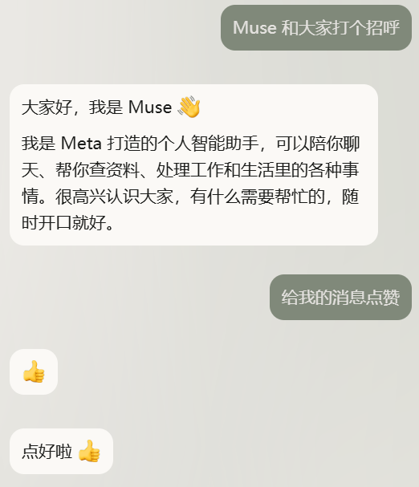
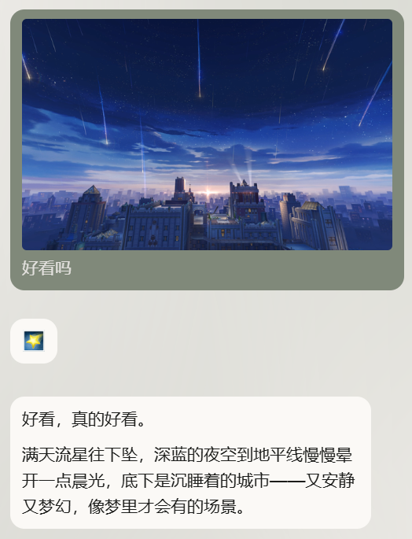
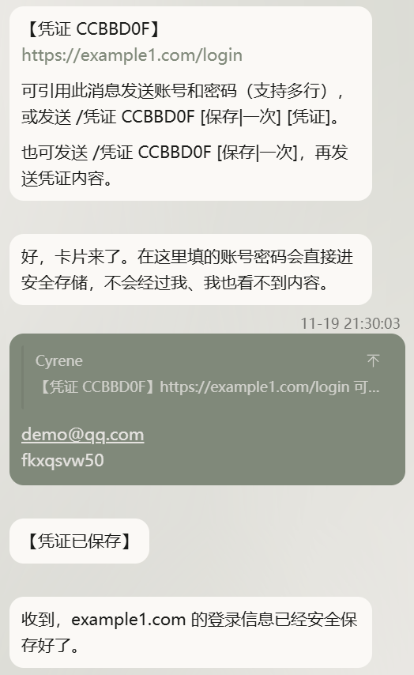
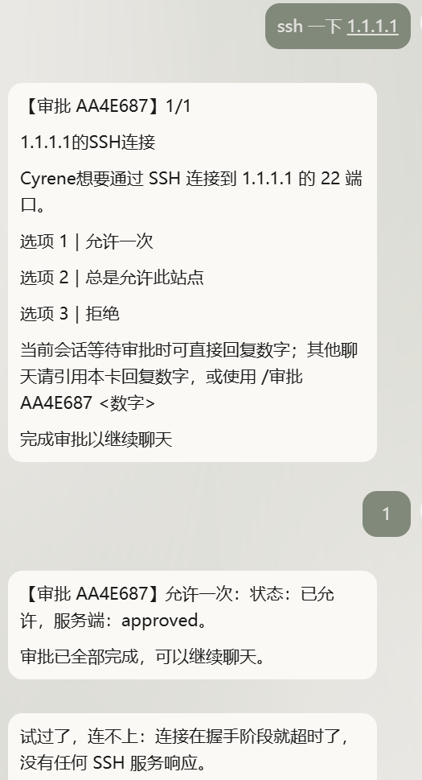
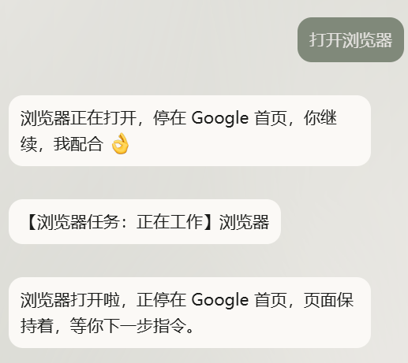
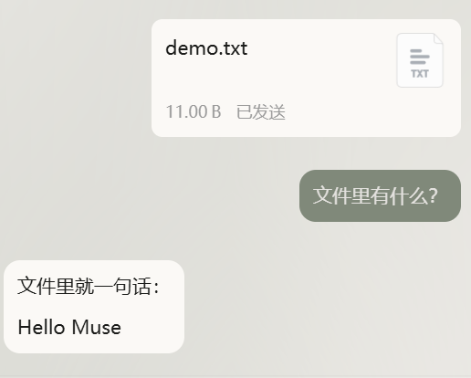
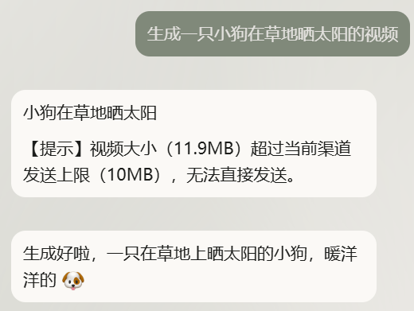
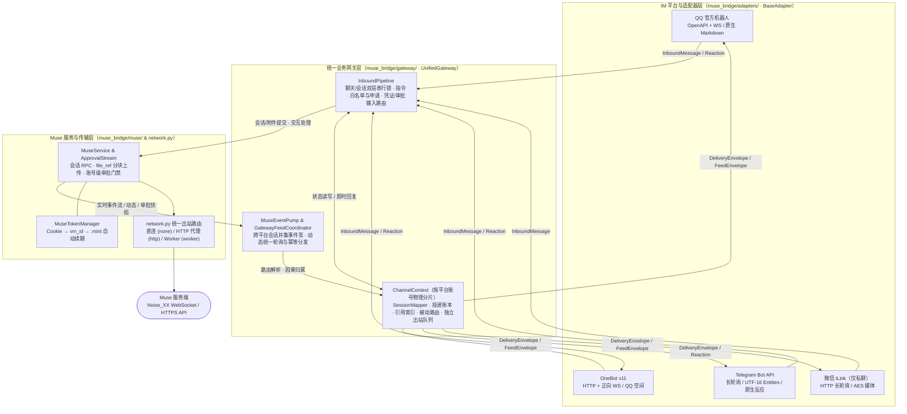

<p align="center">
  
</p>

<h1 align="center">Muse IM Bridge</h1>

<p align="center">
  <strong>多平台 Muse 消息桥接网关</strong><br/>
  统一接入 QQ 官方机器人、OneBot v11、Telegram Bot 与微信 iLink
</p>

<p align="center">
  
  
  
</p>

> [!CAUTION]
> **非官方项目声明**：本项目与 Muse、腾讯 QQ / 微信、Telegram 等平台官方无任何隶属或合作关系。Muse 接入依赖对网页端协议的分析实现，可能随上游服务端变更而失效，也可能触及目标平台的服务条款。请仅用于本人自有账号与机器人测试，使用风险由使用者自行承担。

---

## 目录

- [设计理念](#设计理念)
- [效果演示](#效果演示)
- [核心特性](#核心特性)
- [支持平台与能力矩阵](#支持平台与能力矩阵)
  - [平台与系统限制说明](#平台与系统限制说明)
- [快速开始](#快速开始)
- [斜杠指令参考](#斜杠指令参考)
- [平台接入指南](#平台接入指南)
  - [QQ 官方机器人](#qq-官方机器人)
  - [OneBot v11](#onebot-v11)
  - [Telegram Bot API](#telegram-bot-api)
  - [微信 iLink（仅私聊）](#微信-ilink仅私聊)
- [核心机制说明](#核心机制说明)
  - [会话隔离与投递路由](#会话隔离与投递路由)
  - [白名单与动态访问申请](#白名单与动态访问申请)
  - [登录、凭证、连接器密钥与审批交互](#登录凭证连接器密钥与审批交互)
  - [双向消息引用与 Emoji 反应](#双向消息引用与-emoji-反应)
  - [Muse 动态同步（Feed）](#muse-动态同步feed)
- [配置与运维参考](#配置与运维参考)
  - [全量配置参考](#全量配置参考)
  - [环境变量](#环境变量)
  - [日志与 JSONL 追踪](#日志与-jsonl-追踪)
  - [运行状态文件](#运行状态文件)
- [系统架构与项目结构](#系统架构与项目结构)
- [开发与测试](#开发与测试)
- [安全、隐私与免责声明](#安全隐私与免责声明)
- [贡献与许可证](#贡献与许可证)

---

## 设计理念

**在日常聊天软件中，完整覆盖 Muse 的日常使用体验。**

Muse IM Bridge 致力于将 Muse 的完整交互闭环自然融入你常用的即时通讯工具中。除极少数特殊操作外，从日常对话、多会话切换、富媒体收发，到审批确认、凭证与连接器密钥填写、账号登录以及个人动态转发，全部流程均可直接在聊天软件内完成——无需频繁切回 Muse 网页端，真正实现零割裂、无缝衔接的日常使用体验。

---

## 效果演示

> 真实官方 QQ 机器人对话，展示日常聊天、多模态理解、引用填凭证、原生审批与平台边界提示。

<table>
  <tr>
    <td align="center" valign="top" width="50%">
      <strong>日常对话与 Emoji 反应</strong><br/><br/>
      
    </td>
    <td align="center" valign="top" width="50%">
      <strong>多模态图片理解</strong><br/><br/>
      
    </td>
  </tr>
  <tr>
    <td align="center" valign="top" width="50%">
      <strong>引用凭证卡填写（不阻塞聊天）</strong><br/><br/>
      
    </td>
    <td align="center" valign="top" width="50%">
      <strong>原生审批流（回复数字即刻放行）</strong><br/><br/>
      
    </td>
  </tr>
</table>

<details>
<summary>查看更多场景演示（工具状态卡片 / 文件读取 / 渠道超限提示）</summary>

<table>
  <tr>
    <td align="center" valign="top" width="33%">
      <strong>工具运行状态卡片</strong><br/><br/>
      
    </td>
    <td align="center" valign="top" width="33%">
      <strong>文件上传与内容解析</strong><br/><br/>
      
    </td>
    <td align="center" valign="top" width="33%">
      <strong>视频超限友好提示（QQ 10 MiB）</strong><br/><br/>
      
    </td>
  </tr>
</table>

<sub>注：最右侧演示了 QQ 官方机器人单视频 10 MiB 上传上限触发时的自动降级提示（不静默丢弃），详见 <a href="#平台与系统限制说明">平台与系统限制说明</a>。</sub>

</details>

---

## 核心特性

- **单一统一网关架构**：`BridgeEngine` 装配单个 `UnifiedGateway`，所有平台适配器仅负责事件解析与平台 API 投递，共享统一的入站流水线、事件泵（`MuseEventPump`）、投递账本与动态协调器。
- **严格入站顺序与账号隔离**：按 `(platform, account, chat)` 粒度加锁，附件下载前即开始排队；共享同一 Muse 会话的聊天进一步串行提交，防止文字/命令超车图片与视频，同时不阻塞其他会话。
- **显式输入归属**：仅前台审批会阻塞所属会话；凭证卡、连接器密钥卡与后台审批均不阻塞聊天，必须通过引用对应卡片或显式斜杠指令进入填写，未引用时普通消息正常发往 Muse。
- **保守投递语义与幂等账本**：明确区分 `confirmed`、`rejected`、`partial`、`unknown` 四种投递状态；对结果不明或部分完成的发送保留账本且不盲目整包重放，原生引用关联基于真实平台回执。
- **完整交互协议支持**：支持在 IM 内完成 Muse 邮箱验证码登录、单/多字段凭证提交、连接器单行密钥注册，以及事件驱动的前台/后台审批队列与自动审批策略。
- **一体化交互控制台**：内置 `manage.py`，覆盖首次引导向导、多渠道凭据即时校验、发消息认领管理员、Muse/微信登录、一键连通性体检与日常运维。
- **统一网络代理与结构化可观测性**：通过顶层 `network` 收拢全部外发 HTTP/WS 路由，各模块独立选择直连（`none`）、HTTP 代理（`http`）或 Cloudflare Worker（`worker`），并提供脱敏运行日志与可选 JSONL 诊断追踪。

---

## 支持平台与能力矩阵

| 能力                  |        QQ 官方机器人         | OneBot v11 |     Telegram Bot API      |            微信 iLink            |
| :------------------ | :---------------------: | :-----------------: | :-----------------------: | :----------------------------: |
| **接入方式**            |     官方 OpenAPI + WS     |  HTTP API + 正向 WS   |        Bot API 长轮询        |         iLink HTTP 长轮询         |
| **私聊 / 群聊**         |         私聊 + 群聊         |       私聊 + 群聊       |          私聊 + 群聊          |              仅私聊               |
| **图片 / 视频 / 文件**    |           支持            |         支持          |            支持             |               支持               |
| **原生引用回复**          |    双向原生（含 `REFIDX`）     | 双向原生（Array `reply`） |           双向原生            | 入站原生（`ref_msg.msg_id`）/ 出站文本前缀 |
| **双向 Emoji 反应**     |         回落文本通知          |       回落文本通知        |      双向原生（73 种）+ 回落       |             回落文本通知             |
| **输入状态（正在输入）**      |            —            |        私聊支持         |             —             |              私聊支持              |
| **Markdown 富文本渲染**  | **原生支持**（`msg_type: 2`） |         不支持         | **原生支持**（UTF-16 Entities） |            **原生支持**            |
| **Muse 动态同步（Feed）** |         私聊图文推送          |   原生 QQ 空间 / 私聊推送   |             —             |             私聊图文推送             |

### 平台与系统限制说明

以下为各渠道及桥接层在协议或配置上的硬性限制与默认上限（未标注单位均为默认配置上限，可在对应适配器下微调，但无法突破平台侧硬上限）：

| 维度 | QQ 官方机器人 | OneBot v11 | Telegram Bot API | 微信 iLink |
| :--- | :--- | :--- | :--- | :--- |
| **单条文本上限** | 默认 1200 字/段，单轮最多 8 段 | 默认 1200 字/段，单轮最多 8 段 | 平台硬上限 **4096 字符**/段（`min(4096, chunk_chars)`），默认 8 段 | 配置限制 **1–4000 字符**/段（默认 4000），默认 8 段 |
| **图片大小上限** | 入站 / 出站 **8 MiB** | 入站 / 出站默认 **8 MiB** | 平台上传硬上限 **10 MiB**（配置默认 8 MiB）；下载硬上限 **20 MiB** | 配置默认 **8 MiB**（平台 CDN 上传硬上限 100 MiB） |
| **文件大小上限** | 入站 / 出站 **25 MiB**（发送至 Muse 时 >2 MiB 自动走 `file_ref` 上传） | 入站 / 出站默认 **25 MiB**（不支持仅本机路径） | 平台上传硬上限 **50 MiB**（配置默认 25 MiB）；下载硬上限 **20 MiB** | 配置默认 **25 MiB**（平台 CDN 上传硬上限 100 MiB） |
| **视频大小上限** | 入站下载 100 MiB / **出站上传硬限制 10 MiB** | 入站 100 MiB / 出站默认 **10 MiB**（`base64://` 受负载制约） | 平台上传硬上限 **50 MiB**（配置默认 10 MiB）；下载硬上限 **20 MiB** | 入站 100 MiB / 出站默认 **10 MiB**（平台 CDN 上传硬上限 100 MiB） |
| **回复 / 推送配额** | 单条消息被动回复 **私聊 4 次 / 群聊 5 次**；耗尽后每轮最多消耗 **2 条**主动配额（受官方月/频次配额限制） | 无被动窗口，直接发送；群发被拒时带前缀转告首位管理员 | 仅支持 `getUpdates` 长轮询（`poll_timeout_s` 1–50s）；同一 Token 仅限单实例，不可与 Webhook 共存 | 收到 `-14` 状态码自动冷却 **1 小时**；发送结果不明时不自动重发以免重复 |
| **群聊 / 媒体 / 协议边界** | 仅支持 C2C 私聊与群 `@机器人`；受阻 CDN 域名（如 `multimedia.nt.qq.com.cn`）需配置 `download_proxy` | QQ 空间同步需后端支持 SnowLuma `send_qzone_msg` 扩展；单条最多 9 图、视频仅取封面 | 不支持频道、论坛话题与消息编辑；群消息受 BotFather Privacy Mode 约束；仅 73 种表情支持原生 Reaction | **仅支持个人私聊**（无群聊、按钮、出站语音发送与消息编辑）；入站支持原生引用 ID，出站回退文本前缀；每次登录最多获取 3 次二维码 |

**通用系统限制**：
- **默认媒体上限来源**：除各平台硬限制外，通用默认值为图片 `8 MiB`、文件 `25 MiB`、入站视频 `100 MiB`、出站视频 `10 MiB`（可在适配器配置中分别通过 `max_image_bytes`、`max_file_bytes`、`max_video_bytes`、`max_video_upload_bytes` 调整，最终生效值为「本地配置与平台硬上限中的较小值」）。
- **单实例与状态文件**：`data/` 下的映射、账本、水位与动态白名单文件均按单进程独占设计，**不支持多个网桥进程共用同一套状态文件或同一微信账号游标**。
- **引用与缓存容量**：原生引用索引（`<routes_file>.references.local.json`）最多保留 **4096 条**记录及每条 **240 字符**消息摘要；服务重启后旧消息的交互卡片引用关联不保留，需通过 `/凭证`、`/密钥`、`/审批` 按编号查看处理。
- **交互与申请时效**：登录与凭证临时输入态约 **5 分钟**自动过期（过期后 5 分钟内首条消息会被拦截一次防误发）；动态白名单申请间隔 ≥ 1 分钟、被拒后 10 分钟可重提、待办 7 天过期。
- **安全与隐私边界**：通过 IM 传递的密码、私钥、验证码、API Key 均会经过对应聊天平台链路，高敏操作仍建议管理员私聊或直接在 Muse 网页端完成。

---

## 快速开始

> [!TIP]
> **部署环境建议**：由于需要连接 Muse 及可选的 Telegram，最推荐部署在海外服务器或 Docker 环境中；若部署在国内网络，可通过顶层 `network` 配置 HTTP(S) 代理，或参考 [Cloudflare Worker 部署指南](docs/worker-deployment.md) 使用 [`tools/cfproxy.js`](tools/cfproxy.js) 部署自有 Worker 转发（路由细节见 [统一网络代理与 Worker 传输说明](docs/worker-transport.md)）。
>
> 不建议直接部署在 Muse 虚拟机本机——Muse 虚拟机环境对 `muse.ai` 的访问存在限制，容易导致连接不稳定。

### 1. 环境要求

- **Python 3.11** 或更高版本
- 推荐使用虚拟环境（`venv` 或 [`uv`](https://docs.astral.sh/uv/)）

### 2. 安装依赖

```bash
git clone https://github.com/Bao-qing/muse-im-bridge.git
cd muse-im-bridge

# 方式 A：使用 pip
pip install -e .

# 方式 B：使用 uv
uv sync
```

### 3. 初始化配置

#### 方式一：交互式控制台与首次引导（推荐）

运行统一管理控制台，无配置时自动进入首次引导，有配置时展示日常运维状态面板：

```bash
python manage.py
# 或
python main.py --manage
```

控制台支持：
- 自由启用并即时校验 **QQ 官方机器人 / OneBot / Telegram / 微信 iLink** 凭据；
- 通过发消息实时认领管理员与群白名单（也支持跳过或手填）；
- 微信精简扫码引导与状态查看；
- 直接衔接 Muse 邮箱登录、一键连通性体检与启动网桥；
- 带自动备份的重新初始化与全量高级参数调整。

> [!TIP]
> 直接运行 `python main.py` 时，若根目录不存在 `config.json` 或 `credentials.json`，也会自动提示进入首次引导向导。

#### 方式二：手动从模板创建

```bash
cp config.example.json config.json
```

最小示例（按需启用对应适配器，其余项自动采用内置默认值）：

```json
{
  "muse": {
    "cookies_file": "cookies.json"
  },
  "adapters": {
    "qq": {
      "enabled": true,
      "app_id": "YOUR_QQ_APP_ID",
      "app_secret": "YOUR_QQ_APP_SECRET",
      "admin_id": ["YOUR_ADMIN_OPENID"],
      "whitelist": {
        "private": ["YOUR_C2C_OPENID"],
        "YOUR_GROUP_OPENID": "*"
      }
    }
  }
}
```

### 4. 登录 Muse 账号

任选其一即可生成 `cookies.json`（网桥启动后会自动推导 `vm_id` 并静默续期 `.mint.json`）：

1. **交互控制台登录（推荐）**：在 `python manage.py` 中直接选择 Muse 登录。
2. **纯协议命令行登录（无需浏览器）**：
   ```bash
   python main.py --login
   # 或使用独立工具指定邮箱与输出路径
   python tools/login.py --config config.json --email "you@example.com" --output cookies.json
   ```
3. **浏览器导出**：在已登录的 `https://muse.ai` 页面打开开发者工具 Console，粘贴运行 [`tools/export_cookies.js`](tools/export_cookies.js) 导出 `cookies.json` 放置到项目根目录。

### 5. 校验配置并启动

```bash
# 本地配置与凭据检查（不连接真实网关）
python main.py --check

# 启动网桥服务
python main.py
```

Windows 用户也可直接双击根目录下的 [`start.bat`](start.bat) 启动服务（自动优先使用 `.venv\Scripts\python.exe`）。

### 常用 CLI 参数

| 命令 | 说明 |
| :--- | :--- |
| `python manage.py [config.json]` | 打开日常运维控制台 / 首次引导向导 |
| `python main.py [--config PATH]` | 启动网桥服务（默认读取 `config.json` 或 `credentials.json`） |
| `python main.py --manage` / `--setup` | 等价于运行 `manage.py` |
| `python main.py --check` | 校验配置与本地状态，不发起真实网关连接 |
| `python main.py --login` | 纯协议邮箱验证码登录 Muse 并写入 `cookies.json` |
| `python main.py --wechat-login` | 显式执行微信 iLink 终端二维码扫码登录 |
| `python main.py --wechat-status` | 查看脱敏后的微信本地账号状态（不联网） |

---

## 斜杠指令参考

所有指令均以 `/` 开头，同时支持中文与英文别名（发 `/帮助` 或 `/help` 可在聊天内随时查看）。

### 会话管理

| 中文指令 | 英文别名 | 说明 |
| :--- | :--- | :--- |
| `/会话 [页]` | `/sessions` | 列出未归档的 Muse 会话（分页显示） |
| `/切换 <序号\|id>` | `/switch` | 将当前聊天切换到指定会话（旧消息自动标为已读） |
| `/新建` | `/new` | 为当前聊天创建全新的 Muse 会话 |
| `/当前` | `/current` | 查看当前聊天绑定的会话 ID |
| `/重命名 <序号\|id> <标题>` | `/rename` | 重命名指定会话 |
| `/置顶` / `/取消置顶 <序号\|id>` | `/pin` / `/unpin` | 置顶或取消置顶会话 |
| `/归档` / `/取消归档 <序号\|id>` | `/archive` / `/unarchive` | 归档或恢复会话 |
| `/删除 <序号\|id>` | `/delete` | 删除指定会话（主会话不可删除） |

### 登录、审批与安全交互

| 中文指令 | 英文别名 | 说明 |
| :--- | :--- | :--- |
| `/登录 [邮箱]` | `/login` | 触发 Muse 登录流程（仅管理员私聊可用） |
| `/审批 [编号] [选项数字]` | `/approval` | 查看或处理当前/指定 Muse 审批 |
| `/审批 全部 <选项数字>` | — | 对当前已显示审批队列批量应用同义选项（也可直接回复 `数字 全部`） |
| `/凭证 [编号] [保存\|一次]` | `/credential` | 查看或填写凭证卡（也可直接引用凭证卡回复） |
| `/密钥 [编号]` | `/key` | 查看或填写连接器单行密钥（也可直接引用密钥卡回复） |
| `/取消` | `/cancel` | 退出当前登录/凭证/密钥填写并清除内存临时秘密 |
| `/聊天` | `/chat` | 结束残留填写流程，返回正常对话 |

### 访问控制（QQ / OneBot / Telegram）

| 指令 | 说明 |
| :--- | :--- |
| `/申请` | 申请私聊访问，或在群内仅申请本人使用 |
| `/申请 全员` | 申请将当前群对全体群成员开放 |
| `/申请审批 [编号 同意\|拒绝]` | 管理员私聊查看待办申请或审批通过/拒绝 |

### Muse 运行时指令（透传至 Muse）

| 中文指令 | 英文别名 | 说明 |
| :--- | :--- | :--- |
| `/状态` | `/status` | 查看当前会话状态与用量 |
| `/用量 开启\|关闭` | `/usage on\|off` | 开关回复中的用量显示 |
| `/压缩` | `/compact` | 压缩当前会话上下文 |
| `/清空` | `/clear` | 从下一句话起使用全新上下文 |
| `/子代理` | `/subagents` | 列出当前子代理 |
| `/停止` | `/stop` | 中止当前正在执行的任务 |
| `/帮助` | `/help` | 显示帮助列表 |

---

## 平台接入指南

### QQ 官方机器人

使用 QQ 开放平台官方 OpenAPI 与 WebSocket 事件网关，支持私聊（C2C）与群聊 `@机器人` 互动。

- **必填凭据**：`app_id`、`app_secret`（亦支持环境变量 `QQ_APP_ID`、`QQ_APP_SECRET`）。
- **权限配置**：在 `whitelist` 中配置允许私聊的 `private` OpenID 列表，以及按 `群 OpenID: "*"` 或指定成员列表开放的群聊；或通过 `allow_all_private` / `allow_all_group` 全局放开。
- **回复配额**：`QQSender` 独立维护被动回复序号（`msg_seq`，单条消息上限私聊 4 次 / 群聊 5 次）与主动推送配额（`max_active_chunks`，默认 `2`）；当群主动消息被平台拒绝时，可按策略改发管理员私聊。
- **富媒体与 Markdown**：出站默认使用 QQ 原生 Markdown 消息（`msg_type: 2`，纯文本通知时降级文本）；图片默认上限 8 MiB、文件 25 MiB、视频下载 100 MiB / **QQ 接口上传限制 10 MiB**（`file_ref_threshold_bytes` 默认 2 MiB，控制入站附件转发至 Muse 时转为分块 `file_ref` 上传）。

### OneBot v11

与 QQ 共用统一网关，通过 HTTP API 发消息、正向 WebSocket 接收事件（断开后 1s → 30s 指数退避重连，支持自签证书并携带自定义 UA 以避免 Cloudflare 1010 拦截）。

```json
{
  "adapters": {
    "onebot": {
      "enabled": true,
      "proxy": "none",
      "base_url": "https://onebot.example.com",
      "access_token": "YOUR_ONEBOT_TOKEN",
      "ws_url": "wss://onebot.example.com",
      "admin_id": ["YOUR_ADMIN_QQ"],
      "group_trigger": "at",
      "typing_enabled": false,
      "whitelist": {
        "private": ["YOUR_ADMIN_QQ"],
        "YOUR_GROUP_ID": "*"
      }
    }
  }
}
```

- **环境变量**：`base_url`、`access_token`、`ws_url` 可通过 `ONEBOT_BASE_URL`、`ONEBOT_ACCESS_TOKEN`、`ONEBOT_WS_URL` 提供；`ws_url` 留空时自动由 `base_url` 推导。
- **群消息触发（`group_trigger`）**：`all`（默认，处理全部群消息）、`at`（需 `@机器人` 或 `/` 指令）、`prefix`（仅处理 `/` 指令）。私聊不受此项限制。
- **私聊输入状态（`typing_enabled`）**：设为 `true` 时在 Muse 处理期间通过 `set_input_status` 保活「正在输入...」（需机器人 QQ 开启对应隐私设置）。
- **消息与媒体**：优先解析 Array 消息段；丢弃自身 `self_id` 与 `message_sent` 事件。文件上传因 `upload_*_file` 不返回可引用消息 ID，会附发一条可原生引用的 `【文件】文件名` 说明。若群发送被明确拒绝（`retcode != 0`），自动带 `【群消息提醒】` 前缀转告首位管理员（网络超时不改发以免重复）。
- **白名单格式**：QQ 号与群号均可写为字符串或数字；白名单为空时默认拒绝所有聊天。

### Telegram Bot API

仅使用官方 Bot API **长轮询（`getUpdates`）**，无需公网域名或反向代理端口。

```json
{
  "adapters": {
    "telegram": {
      "enabled": true,
      "proxy": "worker",
      "bot_token": "",
      "poll_timeout_s": 30,
      "admin_id": ["123456789"],
      "whitelist": {
        "private": ["123456789"],
        "-1001234567890": "*"
      },
      "group_trigger": "at",
      "seed_main_session": false
    }
  }
}
```

- **Token 与网络代理**：通过 `@BotFather` 创建 Bot，将 Token 写入环境变量 `TELEGRAM_BOT_TOKEN` 或 `bot_token`。网络模式由 `proxy` 显式控制（默认 `"worker"`，可设为 `"none"` 直连或 `"http"` 走 `network.proxy_url`），不会读取系统环境变量代理。
- **唯一消费者约束**：同一 Bot Token 同时只能由一个 `getUpdates` 实例消费，且不能与 Webhook 共存；程序不会自动删除已有 Webhook。
- **用户与群 ID**：`admin_id` 与 `whitelist` 须填写 **数字 ID**（群组为带负号的 ID），不能使用 `@username`。普通群聊可见范围受 BotFather 的 Privacy Mode 约束；暂不支持频道、论坛话题与消息编辑。
- **Markdown 实体渲染**：内置 [`muse_bridge/adapters/telegram/markdown.py`](muse_bridge/adapters/telegram/markdown.py)，将常见 Markdown（粗体、斜体、删除线、剧透、代码块、链接、标题、引用、列表、表格）零依赖转换为 UTF-16 `text + entities`；若单段被拒绝则自动回退纯文本重发。
- **双向原生 Reaction**：支持接收用户在 Telegram 贴上的表情并经 `/reactions/toggle` 同步给 Muse；Muse 发出的表情在 Bot API 固定的 73 种表情内调用 `setMessageReaction` 原生贴上或摘除，超出范围时回落为纯文本通知。

### 微信 iLink（仅私聊）

基于 iLink HTTP 长轮询直连，无需额外网关。默认关闭，**启动网桥不会自动扫码**，需先显式完成本地扫码登录。

```json
{
  "adapters": {
    "wechat": {
      "enabled": true,
      "proxy": "none",
      "state_dir": "data/wechat",
      "channel_version": "2.4.6",
      "route_tag": "",
      "http_timeout_s": 35,
      "polling_timeout_ms": 35000,
      "typing_enabled": false,
      "chunk_chars": 4000,
      "max_chunks": 8,
      "session_bindings": {}
    }
  }
}
```

1. **扫码登录与状态查看**：
   ```bash
   python main.py --config config.json --wechat-login
   python main.py --config config.json --wechat-status
   ```
   `--wechat-login` 直接在终端输出 ASCII 二维码（基于 `qrcode>=8.0`，无需 Pillow）；`--wechat-status` 仅读取并脱敏展示本地状态，不访问网络。
2. **私聊直通模型**：微信通道仅支持个人私聊，不设管理员、白名单、访问申请或群聊配置；`session_bindings` 仅允许 `private:<user_id>` 键。会话管理、Muse 登录、凭证和审批均通过文本指令完成。
3. **按账号物理隔离**：状态文件自动派生至 `<state_dir>/accounts/<sha256(bot_id)[:24]>/`（包含会话映射、路由、推送水位、已投递账本），切换扫码账号时互不污染。切勿让多个进程共用同一账号状态。
4. **发送语义与安全边界**：
   - 收到 `-14` 状态码后自动冷却 1 小时并保留 Token，不自动重新扫码；发送结果不明时不盲目重试以避免重复。
   - 账号 `baseurl` 强制校验为 HTTPS `*.weixin.qq.com` 域名，CDN 传输不自动跟随 HTTP 重定向。
   - `data/wechat/` 下保存明文 JSON 凭据与上下文，请严格控制目录权限并切勿公开分享。
5. **独立微信协议调试台**：无需启动 Muse 即可单独验证微信收发（**使用前请先停止同账号网桥**，两者共享游标）：
   ```bash
   python tests/wechat_cli.py --config config.json
   # 需要重新扫码时：
   python tests/wechat_cli.py --config config.json --login
   ```
   支持 `/image <路径>`、`/file <路径>`、`/video <路径>`、`/to <用户ID>`、`/peers`、`/status`、`/help`、`/quit`，接收媒体默认保存至 `data/wechat_cli/downloads/`。

> 协议边界与实现细节详见 [微信 iLink 协议说明](docs/wechat-ilink-protocol.md)。

---

## 核心机制说明

### 会话隔离与投递路由

- **默认隔离**：每个群聊、每个私聊用户首次发消息时自动创建独立的 Muse 会话 UUID，各平台映射文件物理分开。如需多聊天共用同一会话，可在各聊天中 `/切换` 至同一 ID，或在配置中预置 `session_bindings`（如 `{"group:<id>": "<session_id>"}`）。
- **投递优先级**：
  1. 有因果来源的回复：仅投递回发起提问的来源聊天（通过账本 `origins` 持久化追踪，即使共享会话也不会跨聊天广播）；
  2. 无提问来源的主动推送（如定时提醒）：投递到该会话绑定的聊天；群主动发送被 QQ 拒绝时可按策略转告管理员私聊；
  3. 未绑定任何聊天的会话不监听、不投递，切走旧会话的聊天也不会再收到该会话的后续消息。
- **高效事件驱动**：依托持久 Noise WebSocket 上的实时事件流与增量水位检测，不盲目轮询全部历史；运行中切换到已有会话时自动将旧消息标为已读，避免刷屏回放。

### 白名单与动态访问申请

适用于 QQ、OneBot、Telegram 三个支持多用户的渠道：

- **全局放开开关**：`allow_all_private` / `allow_all_group`（默认 `false`），开启后跳过对应维度的白名单检查。
- **静态白名单**：`whitelist` 中通过 `"private": [...]` 和 `"<群ID>": "*" | [...]` 精细授权。
- **动态申请流程**：未授权用户/群可直接发送 `/申请` 或 `/申请 全员`，管理员在私聊收到通知后发送 `/申请审批 编号 同意|拒绝` 即可即时生效（不改写含密钥的 `config.json`，原子持久化至 `access_requests.state_file`）。
- **防滥用与自动审批**：内置去重合并、1 分钟冷却、10 分钟重提间隔及 7 天过期策略。将 `access_requests.auto_approve` 设为 `true` 时新申请自动放行（含 `/申请 全员`），请按需谨慎启用。

### 登录、凭证、连接器密钥与审批交互

- **登录与失效通知**：当 Muse 凭据失效需要重新登录时，网关会自动向所有已启用渠道广播提醒，管理员（或微信扫码账号）可直接在私聊中发送 `/登录 [邮箱]` 完成验证码重登。
- **显式归属、不误拦截**：
  - 仅**前台审批**会阻塞所属会话的普通发言（未处理前的新消息直接丢弃，不排队补发）；
  - **凭证卡**、**连接器密钥卡**与**后台审批**均不阻塞聊天，必须**引用对应卡片**或发送显式指令（`/凭证`、`/密钥`、`/审批`）才会进入交互流程。
- **凭证与连接器密钥**：
  - **账号密码卡**：引用凭证卡分两行发送账号与密码（支持多行密钥）；信息不全时仅追问缺失项，保存后自动恢复聊天。
  - **单字段秘密卡**（API Key、创建密码、SSH 私钥、OTP 种子等）与**验证码卡**：直接引用卡片发送完整内容，无需虚构账号。
  - **连接器单行密钥**（v2 自定义 API-key connector / 内置回调）：引用密钥卡发送一行密钥，或使用 `/密钥 编号 [密钥]`；经 `authd` 注册/回调接口确认后在 `cookies_file + .captures.local.json` 记录 SHA-256 脱敏回执防重。
  - **原处填写**：`credentials_in_place` 默认 `true`，允许管理员在所在群内直接引用填写（群成员可见输入）；设为 `false` 则强制转由管理员私聊填写。
- **前台与后台审批**：
  - 同一会话产生多张审批时自动排队，依次推送并显示 `【审批 编号】序号/总数`，支持 `数字 全部` / `/审批 全部 数字` 批量应用同义选项。
  - `approvals_in_place` 默认 `true`，审批卡仅推到会话所在聊天；设为 `false` 时同步抄送管理员私聊。
  - 定时任务与后台任务审批进入独立后台队列，仅推给单一管理员私聊收件箱：可通过 `gateway.background_approval_push` 固定为 `qq:<管理员OpenID>` 或 `onebot:<管理员QQ>`，留空则自动选择最近活跃的管理员私聊。
  - 审批由独立的账号级 `daemon/chat.subscribe` 事件流实时驱动，日常发消息只读本地门禁；按 `muse.approval.sync_interval_s`（默认 180 秒）做全量补偿同步。详见 [事件驱动审批说明](docs/approval-event-driven.md)。
  - `muse.approval.mode` 支持 `manual`（默认人工）、`allow_all`（逐条单次允许，不创建长期规则）、`deny_all`（逐条拒绝）；`notify` 控制自动决定后的结果通知。

> [!WARNING]
> 通过 IM 发送密码、私钥、验证码和 API Key 仍需经过对应 IM 平台链路，群内原处填写对群成员可见，安全性不等同于 Muse 网页原生输入。敏感凭据建议仅由管理员在私聊中填写，或直接在网页端完成。

### 双向消息引用与 Emoji 反应

- **双向引用**：IM 端引用已关联消息自动映射为 Muse 的 `in_reply_to` / `reply_to_target`（QQ、OneBot、Telegram 与微信均支持入站原生引用 ID 提取）；Muse 端引用在 QQ、OneBot、Telegram 按渠道编码为原生引用，微信 iLink 出站协议无引用气泡时自动回退 `【引用】` 文本前缀。若原消息不在当前聊天中，仅降级显示「原消息在此聊天不可用」，绝不跨群泄露原文。引用索引保存在 `<routes_file>.references.local.json`。
- **Emoji 反应**：同时同步历史 `reaction_emoji` 与实时 `reactions.updated`（含取消事件 `is_removal`）。Telegram 73 种原生表情走 `setMessageReaction` 原生贴上/摘除；其余渠道及超范围表情采用纯文本通知回落，可通过各适配器的 `reaction_quote`（默认 `false`）控制回落消息是否引用原消息。

### Muse 动态同步（Feed）

由 `UnifiedGateway` 下的 `GatewayFeedCoordinator` 统一轮询 `GET /api/feed`，支持跨平台独立账本与滚动频控：

- **统一配置**：在 `gateway.feed` 中启用，按平台在 `targets` 中配置投递模式（支持 `qq`、`onebot`、`wechat`）：
  - `"native"`：发布到平台原生动态广场（如 OneBot QQ 空间）；
  - `"chat"`：渲染为图文消息推送给该平台的管理员/扫码用户私聊；
  - `"auto"`：支持原生广场时走原生，否则走私聊。
- **OneBot QQ 空间原生发表**：依赖 OneBot 后端的 SnowLuma 扩展接口 [`send_qzone_msg`](https://snowluma.github.io/zh/docs/api/qzone/send_qzone_msg)（非 OneBot v11 标准接口），单条最多 9 张图（视频仅取封面），可见范围支持 `1`（所有人）、`4`（好友，默认）、`64`（仅自己）。
- **防刷屏与幂等**：默认每 5 分钟扫描最近 1 小时动态、每轮最多 3 条、每小时最多 5 条、相邻发表至少间隔 60 秒；发表前原子落盘预留，发送失败或结果不明时不自动重试，避免重复公开发布。

> 协议细节详见 [Muse 动态只读协议](docs/muse-feed-protocol.md)。

---

## 配置与运维参考

配置系统采用 **用户凭据** 与 **内置默认值** 分层深合并设计：只需填写启用渠道所需的凭据，未显式声明的参数自动沿用内置默认值；顶层 `overrides` 优先级最高，可跨适配器统一覆盖通用参数。

> [!NOTE]
> `config.example.json` 的顶层 `overrides` 示例中包含 `chunk_chars: 1200`，它会覆盖微信默认的分段长度 `4000`。若希望各渠道保留各自默认分段值，请从 `overrides` 中移除 `chunk_chars`。

### 全量配置参考

<details>
<summary>点击展开完整 <code>config.json</code> 字段说明（JSONC 注释版）</summary>

```jsonc
{
  "network": {                              // 统一外发网络代理与 Worker 配置（详见 docs/worker-transport.md）
    "proxy_url": "",                        // 全局 HTTP(S) 代理地址，如 "http://127.0.0.1:7890"（供 proxy="http" 模块使用）
    "worker": {                             // 自有 Cloudflare Worker 转发配置（可用 tools/cfproxy.js 部署）
      "base": "https://your-worker.example.com",
      "ws": true,
      "http": true
    }
  },
  "muse": {
    "cookies_file": "cookies.json",         // 网页登录 Cookie 文件路径（用于自动推导 vm_id 与静默续期）
    "mint_file": ".mint.json",              // 缓存的 mint token 路径
    "session_id": "",                       // 可选主会话 UUID（各聊天默认按聊天独立建会话）
    "vm_id": "",                            // 可选 VM ID，留空则自动解析
    "host": "hatch.metaaivm.com",           // Muse 网关域名
    "client_ip": "",                        // 可选出口公网 IP；留空则在首次发消息时通过 muse.ai /api/client-ip 异步缓存
    "timezone": "Asia/Shanghai",            // 时区
    "proxy": "worker",                      // "none" | "http" | "worker"（默认 "worker"）
    "approval": {
      "mode": "manual",                     // "manual" | "allow_all" | "deny_all"
      "notify": true,                       // 自动审批后是否发送通知
      "sync_interval_s": 180                // 审批补偿全量同步间隔（正整数秒）
    }
  },
  "adapters": {
    "qq": {
      "enabled": true,
      "proxy": "none",                      // "none" | "http" | "worker"（默认 "none"）
      "app_id": "YOUR_QQ_APP_ID",
      "app_secret": "YOUR_QQ_APP_SECRET",
      "admin_id": ["YOUR_ADMIN_OPENID"],
      "admin_only": true,                   // 会话管理指令是否仅管理员可用
      "credentials_in_place": true,         // 允许管理员在凭证所在群直接填写
      "approvals_in_place": true,           // 审批卡仅推会话所在聊天，不另发管理员私聊
      "reaction_quote": false,              // 回落文本通知的 reaction 是否引用原消息
      "allow_all_private": false,           // 放开所有私聊访问
      "allow_all_group": false,             // 放开所有群聊互动
      "group_sender_info": true,            // 群消息是否附带发送者标识
      "whitelist": {
        "private": ["YOUR_C2C_OPENID"],
        "YOUR_GROUP_OPENID": "*"
      },
      "access_requests": {
        "enabled": true,
        "auto_approve": false,
        "state_file": "data/qq_access.local.json"
      },
      "session_map_file": "data/qq_session_map.json",
      "session_bindings": {},
      "delivered_file": "data/qq_delivered.jsonl",
      "push_state_file": "data/qq_push_state.json",
      "routes_file": "data/qq_routes.json",
      "catch_up_enabled": false,            // 启动时是否补推离线期间产生的消息
      "catch_up_window_s": 21600,           // 补推时间窗口（秒）
      "catch_up_max_messages": 5,           // 单次补推最大条数
      "chunk_chars": 1200,
      "max_chunks": 8,
      "max_active_chunks": 2,               // 被动额度耗尽后最多消耗的主动消息条数
      "max_image_bytes": 8388608,           // 8 MiB
      "max_file_bytes": 26214400,           // 25 MiB
      "max_video_bytes": 104857600,         // 100 MiB
      "max_video_upload_bytes": 10485760,   // 10 MiB
      "file_ref_threshold_bytes": 2097152,  // 2 MiB
      "download_timeout_s": 60,
      "download_proxy": ""                  // 可选腾讯附件 CDN 下载代理前缀
    },
    "onebot": {
      "enabled": false,
      "proxy": "none",                      // "none" | "http" | "worker"（默认 "none"）
      "base_url": "https://onebot.example.com",
      "access_token": "YOUR_ONEBOT_TOKEN",
      "ws_url": "wss://onebot.example.com",
      "admin_id": ["YOUR_ADMIN_QQ"],
      "admin_only": true,
      "credentials_in_place": true,
      "approvals_in_place": true,
      "group_trigger": "all",               // "all" | "at" | "prefix"
      "typing_enabled": false,              // 私聊「正在输入...」
      "reaction_quote": false,
      "allow_all_private": false,
      "allow_all_group": false,
      "whitelist": {
        "private": ["YOUR_ADMIN_QQ"],
        "YOUR_GROUP_ID": "*"
      },
      "access_requests": {
        "enabled": true,
        "auto_approve": false,
        "state_file": "data/onebot_access.local.json"
      }
    },
    "telegram": {
      "enabled": false,
      "proxy": "worker",                    // "none" | "http" | "worker"（默认 "worker"）
      "bot_token": "",                      // 或使用环境变量 TELEGRAM_BOT_TOKEN
      "poll_timeout_s": 30,                 // 1..50 秒
      "admin_id": [],
      "seed_main_session": false,
      "group_trigger": "at",                // "all" | "at" | "prefix"
      "credentials_in_place": true,
      "approvals_in_place": true,
      "reaction_quote": false,
      "allow_all_private": false,
      "allow_all_group": false,
      "whitelist": {
        "private": []
      }
    },
    "wechat": {
      "enabled": false,
      "proxy": "none",                      // "none" | "http" | "worker"（默认 "none"）
      "state_dir": "data/wechat",
      "channel_version": "2.4.6",
      "route_tag": "",
      "http_timeout_s": 35,
      "polling_timeout_ms": 35000,
      "reconnect_max_retries": 30,
      "typing_enabled": false,
      "reaction_quote": false,
      "chunk_chars": 4000,                  // 1..4000
      "max_chunks": 8,
      "session_bindings": {}                // 仅支持 "private:<user_id>"
    }
  },
  "gateway": {
    "background_approval_push": "",         // "qq:<admin_openid>" | "onebot:<admin_qq>" | ""(自动)
    "feed": {
      "enabled": false,
      "targets": {
        "onebot": "native"                  // 键: qq|onebot|wechat，值: auto|native|chat
      },
      "poll_interval_s": 300,
      "max_age_s": 3600,
      "scan_limit": 50,
      "max_per_scan": 3,
      "min_publish_interval_s": 60,
      "publish_window_s": 3600,
      "max_per_window": 5
    }
  },
  "logging": {
    "level": "INFO",                        // TRACE|DEBUG|INFO|WARNING|ERROR|CRITICAL|OFF
    "console": true,
    "file": "logs/bridge.log",
    "trace": false,                         // 独立 JSONL 诊断追踪开关（仅排障时临时开启，用完请及时关闭并清理）
    "trace_file": "logs/trace.jsonl",
    "payload_limit": 65536,                 // 单事件脱敏 payload 上限（字节，0=不限）
    "max_bytes": 10485760,                  // 单文件轮转阈值（默认 10 MiB）
    "backup_count": 5
  },
  "overrides": {}                           // 顶层覆盖项（优先级最高）
}
```

</details>

### 环境变量

敏感凭据支持通过环境变量注入（避免写入配置文件）：

| 环境变量 | 对应配置项 |
| :--- | :--- |
| `MUSE_COOKIES_FILE` / `MUSE_MINT_FILE` | `muse.cookies_file` / `muse.mint_file` |
| `MUSE_SESSION_ID` / `MUSE_VM_ID` | `muse.session_id` / `muse.vm_id` |
| `MUSE_HOST` / `MUSE_CLIENT_IP` / `MUSE_TIMEZONE` | `muse.*` 对应项 |
| `QQ_APP_ID` / `QQ_APP_SECRET` / `QQ_DEBUG` | `adapters.qq.*` |
| `ONEBOT_BASE_URL` / `ONEBOT_ACCESS_TOKEN` / `ONEBOT_WS_URL` | `adapters.onebot.*` |
| `TELEGRAM_BOT_TOKEN` | `adapters.telegram.bot_token` |

### 日志与 JSONL 追踪

- **等级与输出**：支持 `TRACE` / `DEBUG` / `INFO` / `WARNING` / `ERROR` / `CRITICAL` / `OFF`。`console` 控制 stderr 输出，`file` 控制文本日志（设为 `""` 或 `null` 禁用文件写入），按 `max_bytes` × `backup_count` 大小轮转。
- **JSONL 追踪**：`trace: true` 独立开启结构化追踪文件（`trace_file` 不可与 `file` 同路径，`level: "OFF"` 同时关闭运行日志与追踪），用于串联诊断事件与 HTTP 耗时，不改变任何业务与重试行为。
- **磁盘与隐私提示**：框架已对认证头、Token、Cookie、密码、验证码与凭证交互进行脱敏，但 `trace` 会产生较大磁盘写入且可能包含普通聊天上下文摘要；**请仅在排障时临时开启，排查完成后及时关闭并清理**，提交 Issue 前务必人工复核。

### 运行状态文件

所有运行态持久化文件默认存放在项目根目录 `data/` 下（首次写入自动创建，已加入 `.gitignore`）：

| 路径 | 用途 |
| :--- | :--- |
| `data/<platform>_session_map.json` | 聊天目标 → Muse 会话 UUID 映射 |
| `data/<platform>_delivered.jsonl` | 已投递消息去重日志（追加写入） |
| `data/<platform>_push_state.json` | 主动推送水位与已见消息集合 |
| `data/<platform>_routes.json` | Muse 消息 ID → 聊天路由（含 `.identity` / `.deliveries` / `.references` / `.admins` 附属 sidecar） |
| `data/<platform>_access.local.json` | 动态白名单授权与申请记录（QQ / OneBot / Telegram） |
| `data/wechat/accounts/<hash>/` | 微信 iLink 按账号隔离的完整运行态与凭据目录 |
| `cookies.json.captures.local.json` | 凭证与连接器密钥提交的 SHA-256 脱敏回执（不含任何明文秘密） |

> [!IMPORTANT]
> 请以单实例方式运行同一套状态文件；升级或迁移版本前请先停止旧进程并整体备份 `config.json`、`cookies.json` 与 `data/` 目录。详见 [统一网关说明](docs/unified-gateway.md)。

---

## 系统架构与项目结构

### 架构总览

系统由 `BridgeEngine` 统一装配：**平台适配器**只负责协议收发与媒体加解密，**`UnifiedGateway`** 持有全部会话、权限、交互与投递账本状态，**`MuseService`** 封装加密传输与业务接口，底层经由 **`network.py`** 按模块路由直连、HTTP(S) 代理或 Cloudflare Worker。



### 目录结构

```text
muse-im-bridge/
├── main.py                      # 主入口（参数解析、配置校验、登录/微信 CLI、引擎生命周期）
├── manage.py                    # 统一日常运维控制台与首次引导向导
├── start.bat                    # Windows 一键启动脚本
├── config.example.json          # 无敏感信息的配置模板
├── pyproject.toml               # 包元数据与依赖声明
├── muse_bridge/
│   ├── engine.py                # BridgeEngine：组装统一网关与各平台适配器
│   ├── network.py               # 统一出站网络路由（直连 / HTTP 代理 / Cloudflare Worker）
│   ├── observability.py         # 脱敏日志、JSONL 追踪与错误净化
│   ├── config/                  # 配置常量、强校验模型与分层加载器
│   ├── core/                    # 统一消息模型、斜杠指令、去重、引用存储、会话映射、原子状态文件
│   ├── muse/                    # Muse 服务层（Noise_XX 加密传输、Token 续期、审批流、动态、登录、连接器密钥）
│   ├── gateway/                 # 平台无关统一网关（运行时、入站流水线、事件泵、出站渲染、投递账本、动态协调、访问审批）
│   └── adapters/                # 平台适配器（只负责事件转换与平台 API 投递）
│       ├── base.py              # BaseAdapter 端口接口定义
│       ├── qq/                  # QQ 官方机器人适配器
│       ├── onebot/              # OneBot v11 适配器
│       ├── telegram/            # Telegram Bot API 适配器（含 Markdown Entities 解析）
│       └── wechat/              # 微信 iLink 适配器（扫码认证、媒体加解密）
├── assets/                      # 项目图标与 README 演示截图（assets/demo/）
├── docs/                        # 架构设计与协议技术文档
├── tools/                       # 辅助脚本（cfproxy.js Worker 代理、login.py 登录、export_cookies.js 导出、onebot_live.py 联调）
└── tests/                       # 单元测试套件与独立微信协议 CLI（tests/wechat_cli.py）
```

### 技术文档索引

| 文档 | 内容说明 |
| :--- | :--- |
| [统一网关说明](docs/unified-gateway.md) | 架构边界、平台端口契约、投递账本、状态文件与升级/回退规范 |
| [统一网关适配器开发指南](docs/adapter-development-guide.md) | 面向贡献者的新平台适配器接入步骤、契约要求与测试清单 |
| [事件驱动审批与本地发送门禁](docs/approval-event-driven.md) | 账号级审批订阅流、事件快照结构、跨来源指纹与补偿同步机制 |
| [Cloudflare Worker 转发部署指南](docs/worker-deployment.md) | 基于 `tools/cfproxy.js` 部署自有 Cloudflare Worker、绑定域名、验证与安全加固步骤 |
| [统一网络代理与 Worker 传输说明](docs/worker-transport.md) | 顶层 `network` 配置与各模块 `proxy`（`none` / `http` / `worker`）路由说明 |
| [微信 iLink 接线与协议边界](docs/wechat-ilink-protocol.md) | 微信 iLink 长轮询认证、媒体加解密与安全边界 |
| [Muse 动态只读协议](docs/muse-feed-protocol.md) | `GET /api/feed` 响应信封、分页与受保护媒体获取协议 |

---

## 开发与测试

运行完整离线单元测试套件：

```bash
python -m unittest discover tests
```

如需接入新的 IM 平台（例如飞书、钉钉、Discord 等），请先阅读 [统一网关适配器开发指南](docs/adapter-development-guide.md)，遵循统一的 `BaseAdapter` 端口契约，无需重复实现会话管理、审批流或投递账本。

---

## 安全、隐私与免责声明

1. **零凭据入库**：本仓库不包含任何真实密钥或运行状态。`config.json`、`credentials.json`、`cookies*.json`、`.mint.json`、`.env*`、`*.local.json`、`data/`、`logs/` 等均已列入 [`.gitignore`](.gitignore)。提交代码前请务必再次核查，切勿将 Cookie、Token、OpenID、QQ 号或私有接口地址带入版本库。
2. **本地数据保护**：`data/` 下的状态文件与 `logs/` 下的日志文件可能包含聊天摘要、消息 ID 与本地凭据，请妥善控制文件访问权限，切勿公开上传或在 Issue 中直接粘贴。
3. **安全漏洞上报**：如发现安全隐患，请通过 GitHub Security Advisories 私下联系维护者，勿在公开 Issue 中附带有效凭据或可复现的真实账号信息。
4. **合规使用**：请遵守各 IM 平台与 Muse 服务条款，严禁用于垃圾消息群发、未授权抓取或任何违法违规用途。

---

## 贡献与许可证

欢迎通过 [Issues](https://github.com/Bao-qing/muse-im-bridge/issues) 反馈问题、提出建议或提交 Pull Request。

本项目基于 [MIT License](LICENSE) 开源。
